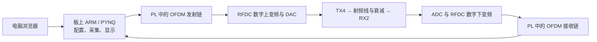

# P047Pro 从 OFDM 到 AFDM 的学习与开发路线

编写日期为 2026 年 11 月 12 日。适用于 FPGA 与通信基础较少、希望在一周左右看到 OFDM 收发演示，并最终在 P047Pro 上实现 AFDM 收发机的开发者。

## 1. 当前最合适的路线

**第一周优先复现厂家已经适配的 PYNQ OFDM 收发机。随后补齐可校验的数据收发、源码重建和算法修改能力，再迁移到 AFDM。**

本地 `5_PYNQ` 资料已经提供 P047Pro 镜像、OFDM 的 `.bit/.hwh`、Python 驱动、演示 Notebook、OFDM 算法模型以及生成的 HDL/IP。厂家指南第 19～20 页说明了 OFDM 演示，射频接线为 **TX4 → RX2**。OFDM 发射和接收算法在 FPGA 的 PL 中运行，Python 负责配置、采集和显示。[厂家 PYNQ 开发指南](05.教程和源码/5_PYNQ/璞致PZSDR系列板卡之P047_P047Pro--PYNQ开发指南.pdf)

这次检查已覆盖教程、压缩包目录和其中的关键源码。PYNQ 镜像的启动、OFDM 射频回环以及当前板卡的实测性能均待执行验证。

### 1.1 将目标分成五个可验收的阶段

| 阶段 | 完成后得到的能力 | 验收依据 |
|---|---|---|
| A，第一周 OFDM 演示 | 启动厂家系统，运行现成 PL OFDM，改变调制并观察接收 | TX4→RX2 回环，实时更新的星座与波形，重复启动成功，参数和数据已保存 |
| B，可校验的 OFDM 数据链路 | 指定发送数据，判断收回的数据是否正确 | 已知序列、帧对齐、发送/接收计数、BER 或 CRC/PER 结果 |
| C，可修改的 FPGA OFDM | 从源码重建板卡设计，并完成有预期结果的修改 | 自建 bitstream 复现阶段 A/B，仿真与板上结果一致 |
| D，AFDM 算法基准与射频原型 | 完成 DAFT/IDAFT、CPP、信道估计与检测，并验证实际射频数据 | 软件回归、受控信道曲线、板端 I/Q 回放采集后的离线解调 |
| E，FPGA 实时 AFDM | 将已验证的 AFDM 数据处理放入 PL | 连续处理、时序收敛、无数据丢失，BER/EVM 与软件基准吻合 |

阶段 A 的原版演示使用硬件随机符号源，现有 Python 接口提供调制控制和链路可视化。自定义消息输入、可重复随机种子、共同帧号和 BER 统计需要在阶段 B 中补充。阶段 B 和 C 可以交错推进，新增硬件接口依赖可重建的工程。

第一周按每天约 3～4 小时、合计约 20～30 小时安排，包含运行、排错和少量学习。后续阶段按验收结果推进。厂家适配工程的获取情况、实际投入和工具兼容性会影响工期。

### 1.2 开发方式

- 主线使用 **PYNQ + Python/Jupyter + 厂家 OFDM overlay**。直接沿用资料中的运行方式和已有接口。
- 软件算法优先使用已有 Python/NumPy Notebook，逐步建立 OFDM/AFDM 参考模型。
- 进入硬件修改后，使用 Vivado、现成 OFDM IP、生成的 HDL 和小规模接口逻辑。
- MATLAB/Simulink 模型用于理解或修改已有算法实现。涉及重新生成 HDL 时，再核对模型版本、依赖工具箱与许可证。
- 每次开发围绕一个可观察的结果展开，学习紧贴当次操作，建议每天用 30～45 分钟补相关概念。

## 2. 先建立够用的系统认识



| 名称 | 在本项目中的用途 | 学会后的实际动作 |
|---|---|---|
| PS | 芯片中的 ARM 处理器，运行 Linux、PYNQ 和 Python | 查看日志、执行 Notebook、读写硬件参数 |
| PL | 芯片中的 FPGA 可编程逻辑，执行连续数据处理 | 找到发射、接收、FFT、同步等模块 |
| RFDC | RF Data Converter，管理 ADC/DAC、混频和部分抽取插值 | 读出采样率、中心频率和通道设置 |
| Overlay | 一组 FPGA 配置和对应的软件描述，主要包括 `.bit/.hwh` | 加载正确的板卡设计并查看 IP 列表 |
| I/Q | 一个复数采样的实部和虚部 | 正确解释复数数组、幅度和相位 |
| 星座图 | 调制符号在 I/Q 平面的位置 | 识别 BPSK、QPSK、16-QAM 及旋转、扩散、削顶 |
| FFT/IFFT | 在子载波符号与时域采样之间转换 | 找到 OFDM 调制和解调的核心位置 |
| CP | 循环前缀，复制 OFDM 符号末尾的一段采样到前面 | 标出符号长度和接收端去前缀的位置 |
| 同步与均衡 | 确定帧位置、补偿频偏，并补偿信道失真 | 对比处理前后的波形和星座 |
| DMA | 在硬件数据流和内存之间搬运数据 | 获取采样数组，理解长度、完成状态与缓冲 |

## 3. 现有资料怎样复用

### 3.1 阅读顺序

| 优先级 | 本地资料 | 只需先看的部分 | 用途 |
|---|---|---|---|
| 第一周必看 | [PYNQ 开发指南](05.教程和源码/5_PYNQ/璞致PZSDR系列板卡之P047_P047Pro--PYNQ开发指南.pdf) | 第 4～5 页启动，第 7～12 页环境与安装，第 19～20 页 OFDM | 跑通主线 |
| 第一周按需 | 同一 PYNQ 指南 | 第 13～16 页 `notebook_A`，第 17～18 页 `notebook_G` | A 用于 NCO 与采集入门，G 用于了解消息与图片传输 |
| 射频排错时看 | [射频开发指南](05.教程和源码/4_RF/璞致PZSDR系列板卡之P047_P047Pro--射频开发指南.pdf) | 第 28～35 页 | 利用裸机例程定位时钟、RFDC、通道问题 |
| 改硬件前看 | [FPGA 开发指南](05.教程和源码/1_FPGA/璞致PZSDR系列板卡之P047_P047Pro--FPGA开发指南.pdf) | §3.1.3 仿真、§3.3 RAM/ILA、§3.6 FIFO | 掌握抓信号、缓冲与仿真 |
| 增加寄存器或 DMA 时看 | [ARM 裸机开发指南](05.教程和源码/2_ARM/璞致PZSDR系列板卡之P047_P047Pro--ARM裸机开发指南.pdf) | 第 2 章串口、第 12 章 AXI-Lite、第 15 章 DMA，DMA 位于第 176～190 页 | 理解软件怎样控制硬件、搬运数据 |
| 自定义系统时再看 | [Linux 开发指南](05.教程和源码/3_Linux/璞致PZSDR系列板卡之P047_P047Pro--Linux开发指南.pdf) | 启动、网络，以及实际需要修改的章节 | 支持后期系统开发 |

工作区还存在 `07.test/led_flash`、`07.test/led_pwm` 和 `07.test/uart`。这些工程可用于复习已有操作，是否已经上板验收以你的实验记录为准。

`notebook_G` 的文本和图片收发属于另一套无线电例程，接线为 TX2→RX2。OFDM 的验收记录应对应 `notebook_I` 或独立 OFDM 演示的运行结果。

### 3.2 压缩包中已经具备的文件

以下路径均位于 [5_PYNQ.rar](05.教程和源码/5_PYNQ/5_PYNQ.rar) 内，使用前先解压所需内容。归档内根目录为 `5_PYNQ/`。

| 归档内相对路径 | 用途 |
|---|---|
| `1_Img/PZ-P047PRO.img` | P047Pro 专用 PYNQ 镜像，厂家指南注明基于 PYNQ 3.0.1 |
| `0_DOC/RFSoC_SDR_book.pdf` | RFSoC Book，按正在运行的实验查阅 |
| `2_Demo_Prj/rfsoc_ofdm/setup.py` | 厂家 OFDM 包安装入口，板型选择为 `rfsoc47dr` |
| `2_Demo_Prj/rfsoc_ofdm/boards/rfsoc47dr/rfsoc_ofdm/bitstream/` | 本板的 `rfsoc_ofdm.bit` 与 `rfsoc_ofdm.hwh` |
| `2_Demo_Prj/rfsoc_ofdm/rfsoc_ofdm/notebooks/02_rfsoc_ofdm_demonstrator.ipynb` | 第一周优先运行的独立 OFDM 入口 |
| 同目录的 `03_voila_rfsoc_ofdm_demonstrator.ipynb` | 演示仪表界面，基本演示通过后再使用 |
| `2_Demo_Prj/rfsoc_ofdm/rfsoc_ofdm/overlay.py`、`clocks.py` | 板卡适配、RFDC 与时钟配置 |
| 同目录的 `ofdm.py`、`inspector.py` | 调制控制与 I/Q 捕获接口 |
| `2_Demo_Prj/rfsoc_ofdm/boards/ip/hdl_coder/` | `OFDM_Tx_HW.slx`、`OFDM_Rx_HW.slx` 和辅助模型、脚本、数据 |
| `2_Demo_Prj/rfsoc_ofdm/boards/ip/iprepo/` | 已生成的 OFDM 发射/接收 HDL 和 IP 描述 |
| `2_Demo_Prj/RFSoC-Book.zip` | 内嵌 ZIP，包含 `notebook_I` 的 OFDM 原理与 Python 收发仿真 |

内嵌 ZIP 中优先阅读 `RFSoC-Book/rfsoc_book/notebooks/notebook_I/01_ofdm_fundamentals.ipynb` 和 `02_ofdm_python_transceiver.ipynb`。硬件演示优先使用上表中的厂家独立 OFDM Notebook，其驱动会选择本板 overlay。

### 3.3 需要第一天就推进的源码事项

**已检查的 `boards/rfsoc47dr/rfsoc_ofdm/` 只包含预编译 bit/hwh，缺少该板的完整 Vivado 重建工程。** 通用 OFDM 算法 HDL/IP 和 Simulink 模型已经提供，其它板卡的工程仍带有各自的器件、时钟与接口配置。

第一周可以使用现成 bitstream。为了后续改成 AFDM，建议第一天就向厂家索取以下内容，同时继续运行演示。

1. 对应当前 `rfsoc_ofdm.bit/.hwh` 的 P047Pro Vivado 工程或完整重建 Tcl。
2. 全部自定义 IP、约束、时钟初始化代码、RFDC 配置及通道映射。
3. Vivado、MATLAB、HDL Coder 等工具的准确版本与需要的许可证。
4. OFDM 数据源、接收采集点、帧边界的接口说明，以及已有 BER 或自定义数据接口。
5. 与 `PZ-P047PRO.img` 匹配的 Python 包和依赖版本。

可直接向技术支持发送下面这段文字。

> 我正在使用 P047Pro 的 PYNQ rfsoc_ofdm 示例，计划在已跑通 OFDM 的基础上修改为 AFDM。本地包中 boards/rfsoc47dr/rfsoc_ofdm/ 目前只有 bit/hwh。请提供与这组文件对应、能从源码重建的 P047Pro Vivado 工程或 Tcl、全部 IP/约束、准确工具版本，并说明发射数据源和接收采集接口。请同时确认是否已有用户数据输入、帧对齐和 BER 统计接口。

本地 OFDM README 沿用了 Vivado 2020.2、MATLAB R2020a 的说明，个别命令文字还出现 2020.1。裸机 `4_RF` 工程使用 Vivado 2023.1。后续重建以厂家确认的 P047Pro 工程版本为准。上游当前支持板卡列表也未包含 P047Pro，厂家适配包应作为本板的运行基线。[上游 OFDM 项目](https://github.com/strath-sdr/rfsoc_ofdm)

## 4. 第一周的每日执行安排

### 第 1 天，准备可启动的实验环境

**学习约 30 分钟。** 了解 PS、PL、PYNQ、SD 启动和 JTAG 启动各自的用途。

**当天操作**

1. 核对供电、散热、Type-C 调试连接，准备网线、Micro SD 卡、读卡器及适配板卡射频接口的线缆。
2. 查看现有 SD 卡是否已经能启动厂家 PYNQ。需要写镜像时，先保留原卡内容，核对目标卡和镜像展开大小，使用 `PZ-P047PRO.img`。
3. 断电调整为 SD 启动，启动后从串口记录日志。串口配置沿用 115200、8N1，上次检查识别到的端口为 COM6，执行时以当前枚举为准。
4. 板卡和电脑连到同一局域网，通过串口 `ip addr` 或教程中的 `ifconfig` 查看板卡地址。
5. 浏览器访问 `http://<板卡IP>:9090/lab`。厂家镜像指南给出的初始密码为 `xilinx`。
6. 发起第 3.3 节的源码索取。

**验收**为可以进入 JupyterLab、执行简单 Python 单元格，并保存串口启动日志、板卡 IP 和系统版本。

若启动或 RFDC 状态异常，调用已经检查过的 `4_RF/4_RF/2_PZ_RF47DR` 裸机例程辅助定位。切换回 PYNQ 时，重新按 SD 启动流程进入厂家系统。

### 第 2 天，安装本地适配包并找到演示入口

**学习约 30 分钟。** 掌握 Notebook 单元格的执行顺序、异常回溯、内核重启和 overlay 加载。

**当天操作**

1. 解压并上传厂家 `rfsoc_ofdm` 包，检查镜像中是否已有对应安装。
2. 按厂家指南第 11 页，在板端进入包目录执行本地安装。安装输出、包路径和 Python/NumPy 版本一并保存。
3. 在首次执行 overlay 加载单元格前，按厂家指南连接 **TX4 → RX2**，准备适用频段的衰减器并核对默认发射幅度。原版初始化会启动星座采集，接收尚未同步时可能等待 DMA 完成，因此回环连接需要提前准备。
4. 优先打开独立 `02_rfsoc_ofdm_demonstrator.ipynb`，检查导入、overlay 加载和 IP 枚举。加载 overlay 会重新配置 PL，切换例程后按对应 Notebook 重新初始化时钟、RFDC 和驱动对象。
5. 仿真学习直接使用本地 RFSoC-Book ZIP 中的 Notebook。完整 Book 安装会拉取额外 GitHub 依赖，可在需要这些功能时再安装。

本地旧包中发现 `install_requires=['']` 和 `np.complex`。若实际出现安装或导入报错，按报错定位对应文件，做最小兼容修正并记录差异。先保留厂家镜像中的依赖版本，新增依赖逐项核对。

**验收**为 OFDM Notebook 能加载本板 overlay，能够显示其控制界面，导入与硬件加载步骤执行完成。

### 第 3 天，跑通 OFDM 射频回环

**学习约 45 分钟。** 理解 I/Q、BPSK/QPSK 星座、收发中心频率和信号幅度。

**当天操作**

1. 复核前一天的 **TX4 → RX2** 回环，记录实际端口与射频附件。首次加载前建议准备适用频段的 10～20 dB 衰减器，运行后从保守发射幅度开始，再结合接收幅度调整。
2. 选择演示支持的 BPSK 或 QPSK，按 Notebook 顺序执行初始化和收发。
3. 查看接收波形与星座，触发新的采集并确认数据更新。
4. 记录当前发射增益、接收设置、频点、调制方式与观察点。

**验收**为连续多次采集都能看到对应调制的稳定接收星座，停止/恢复发射或改变配置时，新的采集结果产生相符变化。

### 第 4 天，理解现成 OFDM 链路

**学习约 45 分钟。** 对照框图认识子载波映射、IFFT、CP、同步、FFT、信道估计和均衡。

**当天操作**

1. 在 Notebook 中依次观察发送、接收和均衡后星座的数据。
2. 切换 BPSK、QPSK，条件允许时再观察 16-QAM，记录星座点数和扩散程度。
3. 阅读 `ofdm.py`、`overlay.py`，找出调制、增益、使能与频点参数的入口。
4. 阅读 Python OFDM 仿真 Notebook，追踪一组符号从映射到 IFFT，再经 FFT 恢复的过程。

**验收**为你能指出一帧数据经过哪些模块，知道改变哪个参数会影响哪个结果，并能恢复到当天的已知可用配置。

### 第 5 天，保存 I/Q 数据并形成实验记录

**学习约 30 分钟。** 掌握采样率、FFT 频率轴、数据类型，以及 EVM 与 BER 各自的计算对象。

**当天操作**

1. 使用现有 `Inspector.get_frame()` 捕获复数采样，保存为 `.npy` 或明确格式的二进制文件。
2. 每份数据同时记录采集点、采样率、长度、调制、增益、时间和软件版本。
3. 画出幅度、I/Q 时域、频谱和星座，核对观察点所对应的采样率。
4. 如果能得到对齐的理想符号，就计算参考 EVM。若仅使用最近星座点估算误差，将结果标为判决导向 EVM，并记录算法。

**验收**为关掉 Notebook 后仍能重新加载保存的数据并重画结果，图中的坐标和参数有依据。

### 第 6 天，检查稳定性与可复现性

**学习约 30 分钟。** 学会通过重复实验区分固定配置问题和偶发数据问题。

**当天操作**

1. 从重新启动或重新初始化开始，完成三次独立运行，记录每次结果。
2. 持续观察约 5～10 分钟，记录采集错误、星座变化和需要重新初始化的情况。
3. 选择两到三个接收幅度或衰减设置进行对比，每次只改变一个变量。
4. 整理成功运行所需的单元格顺序和参数，保存已验证的 Notebook 副本。

**验收**为三次运行都能恢复同样的 OFDM 功能，并且剩余问题都有日志和复现步骤。

### 第 7 天，完成演示与下一阶段交接

**当天操作**

1. 从启动、加载、调制选择到接收显示完整预演一遍。
2. 保存一段演示记录，展示实时采集、调制切换和已保存的数据。
3. 固定本轮使用的镜像、包、bit/hwh 和参数版本。
4. 根据厂家源码回复，选择阶段 B/C 的具体实施方式。

**第一周交付清单**

- [ ] P047Pro 厂家 PYNQ 系统能启动并进入 JupyterLab。
- [ ] TX4→RX2 有线 OFDM 回环成功，收发处理运行在 PL。
- [ ] BPSK/QPSK 的调制切换与接收结果对应。
- [ ] 保存至少一组具有采样率和采集点说明的 I/Q 数据。
- [ ] 完成三次独立启动或初始化后的复现。
- [ ] 留存版本、参数、接线、日志和剩余问题。
- [ ] 明确后续自定义数据、BER 统计和工程重建的接口缺口。

如果第一周主要时间用于镜像或网络排错，按实际结果顺延后续天数，优先完成可重复的基础演示。

## 5. 两套例程的参数要分别记录

| 参数 | 裸机 `4_RF/2_PZ_RF47DR` | PYNQ `rfsoc_ofdm` 厂家适配包 |
|---|---|---|
| 主要用途 | DDS 单音、时钟/RFDC/ILA 验证 | PL OFDM 收发与链路观察 |
| 默认收发中心频率 | 源码配置 1 GHz | 源码默认 600 MHz |
| RFDC 采样率 | 4.9152 GSPS | 3.84 GSPS |
| 基带数据率 | 245.76 MS/s | 基带观察器默认 20 MS/s，较高速观察点为 240 MS/s |
| FFT 与 CP | 该 DDS 测试未使用 OFDM 帧 | 64 点 IFFT，16 点 CP |
| 子载波 | 由 DDS 产生测试信号 | 48 数据、4 导频、12 空子载波 |
| 接收观察 | ILA 只抓每拍四个采样中的第一个 | DMA 捕获不同处理阶段的数据 |

表中数值来自已检查的本地源码，运行时需要读回并记录实际配置。观察器的 tap 标签和频率轴还应与 `.hwh` 中的接线对应。

有效基带采样率还需对照 HDL 时钟、采样使能和插值位置核实。若确认 OFDM 有效基带采样率为 20 MS/s，采用 64 点 FFT，则得到以下计算结果。

- 子载波间隔为 `20 MHz / 64 = 312.5 kHz`。
- 有效符号时长为 `64 / 20 MHz = 3.2 μs`。
- CP 时长为 `16 / 20 MHz = 0.8 μs`，含 CP 的符号时长为 `4 μs`。

数据、导频、空载波和前导共同影响有效吞吐量。记录吞吐量时，应写明统计的是调制比特、有效载荷还是包含协议开销的数据。

## 6. 按任务补足知识

| 使用时机 | 需要掌握的知识 | 够用的练习 | 可暂缓的内容 |
|---|---|---|---|
| 第一周启动 | SD 镜像、串口、IP、Jupyter 内核 | 独立启动系统并找到报错单元格 | Linux 内核和完整 PetaLinux 构建 |
| 第一周看星座 | 复数、幅度相位、BPSK/QPSK/QAM | 画理想 QPSK 并比较实测星座 | 通信理论的系统性证明 |
| 第一周看 OFDM | FFT/IFFT、CP、导频、同步、均衡的作用 | 在仿真 Notebook 中做无噪声收发 | FFT 蝶形的手工 RTL 实现 |
| 保存采样 | 采样率、频谱、量化、数据顺序 | 将一份捕获重新画出正确频谱 | 全套数字滤波器设计理论 |
| 添加数据收发 | 帧头、序列号、CRC、BER/PER、对齐 | 已知序列收发后逐位比较 | 完整 Wi-Fi/5G 协议栈 |
| 第一次改 PL | 时钟、复位、寄存器、位宽、有符号数、AXI-Stream | 仿真一个带握手的计数器/FIFO，并检查丢数 | 与当前链路无关的外设练习 |
| 引入 DMA | 缓冲、长度、TLAST、缓存一致性、跨时钟域 | 有限长度已知数据搬运和校验 | 一开始就追求连续满速多通道 |
| AFDM 模型 | DAFT、chirp 相位、CPP、延迟/多普勒信道 | 自恢复、退化 OFDM、受控信道检测 | 先完整推导连续仿射变换理论 |

每个模块都用四个问题检验理解程度——输入是什么，输出是什么，哪个参数控制它，怎样判断结果正确。遇到问题时，优先查看与这四项直接相关的资料。

## 7. 第一周之后，完成可校验、可修改的 OFDM

### 7.1 增加已知数据与 BER/PER 统计

现有 OFDM 数据由 PL 随机符号源产生。已检查的 Python API 提供三个观察器 `transmitter`、`receiver`、`constellation`，均通过 S2MM DMA 抓取数据。发射和接收各调用一次 `get_frame()` 时，捕获的时间窗口可能不同。

依次完成以下工作。

1. 找到发射符号源、前导插入、数据子载波映射与接收判决位置。
2. 加入可重复的已知比特序列，并提供帧号、固定长度或明确的对齐依据。
3. 在接收端导出判决比特及对应帧信息，统计发送数、接收数、丢帧数、错误比特数。
4. 先做无信道的数字仿真，再做板内数据校验，最后做射频线缆回环。
5. 逐步扩展到任意短消息，按帧校验内容，加入 CRC 和重放测试。

建议的阶段验收是固定参数下累计比较至少 `10^6` 个有效载荷比特，并明确对齐方式、错误数、丢帧数和统计时长。若观测到零错误，记录“本次 N 个比特中观测到 0 个错误”。误码表现异常时同时检查前端削顶、同步丢失和位宽截断。

### 7.2 先原样重建，再改一个模块

拿到本板工程后，先从源码生成一套可复现原版 OFDM 的 bit/hwh。将算法参数、时钟、IP 版本和接口位宽整理出来，再完成一个范围清楚的修改，例如增加状态寄存器、可重复数据源或错误计数。

如果厂家暂时无法提供完整工程，可以基于已能重建的 `4_RF` 工程，逐步集成包内的 OFDM TX/RX IP。需要补齐采样率转换、RFDC 接口适配、时钟复位、寄存器、采集和软件驱动，这项工作应单独估算。

使用 FFT IP 时，应对齐输出顺序、缩放和 IFFT 归一化。AXI-Stream 仿真需要覆盖握手停顿。每个修改先用已知输入比对软件模型，再上板观察。[AMD FFT 产品指南 PG109](https://www.amd.com/content/dam/xilinx/support/documents/ip_documentation/xfft/v9_1/pg109-xfft.pdf)

## 8. 从 OFDM 迁移到 AFDM

### 8.1 先建立与硬件独立的算法基准

在 Python 中建立单独的 AFDM 参考模型，并保留 OFDM 模式。沿用原论文的单位化 DFT 约定，定义

```text
A = Λ(c2) · F · Λ(c1)
Λ(c) 的第 n 个对角元素 = exp(-j·2π·c·n²)

发送  x → Λ(c2)ᴴ → IFFT → Λ(c1)ᴴ → CPP
接收  去 CPP → Λ(c1) → FFT → Λ(c2) → 信道检测 → 符号判决
```

这里 `ᴴ` 表示共轭转置。代码中统一正负号、索引和 FFT 归一化，`numpy.fft.ifft` 的默认缩放应显式纳入模型。[AFDM 原论文](https://arxiv.org/abs/2204.12798)

按下面的顺序验收。

1. **无信道自恢复**。对随机复数符号执行 IDAFT 与 DAFT，数值误差符合浮点精度预期。
2. **退化 OFDM**。设 `c1=c2=0`，结果与相同归一化的 OFDM 模型一致。
3. **前缀检查**。按 AFDM 定义实现 CPP。论文给出的一个充分条件是 `N` 为偶数且 `2Nc1` 为整数时，CPP 等于普通 CP，选参时验证该条件及实际输出。
4. **逐层加入信道**。依次测试 AWGN、静态多径、整数 Doppler 和分数 Doppler。先用已知信道检查检测器，再加入导频和信道估计。
5. **公平比较**。固定平均发射功率、采样率、帧长、带宽约束、导频/前缀开销和统计口径，比较 OFDM/AFDM 的 BER 曲线。

AFDM 在多径和多普勒条件下的有效信道、导频设计和检测方法需要相应调整。FFT 两侧的 chirp 乘法提供变换结构，接收端还需按模型实现信道估计与检测。[AFDM 原论文](https://arxiv.org/abs/2204.12798)

### 8.2 利用板卡完成 AFDM 射频原型

先在电脑生成有限长度 AFDM I/Q，在板端连续回放该波形并采集接收数据，然后回电脑同步、解调和统计。这能将 RFDC、数据格式和算法的检查集中到同一组已知样本上。

当前 OFDM overlay 的三个 DMA 均只包含 S2MM，任意 I/Q 回放需要新增 MM2S 或 BRAM 回放通路。选型时根据实际帧长和需要的实验次数决定。

| 通路 | 适用阶段 | 需要实现的内容 |
|---|---|---|
| BRAM 有限帧回放与抓取 | 较短波形、首个射频验证 | 波形装载、循环播放、采集窗、数据读回与计数 |
| DDR + DMA 回放与抓取 | 多帧、较长记录、反复更换波形 | MM2S/S2MM、缓冲、包长度、跨时钟域、异常处理 |

射频采样率、RFDC 插值/抽取、PL 的数据率转换和 AFDM 基带采样率共同决定整条链路。按选定的速率关系生成与采集波形，逐级核对频谱和样本数量。

### 8.3 迁移到 PL 的复用关系

| 模块 | 迁移方式 |
|---|---|
| 板卡启动、LMK 时钟、RFDC 配置 | 在验证过的参数范围内复用 |
| 寄存器、数据缓存、DMA、观察接口 | 复用并增加需要的状态和计数 |
| FFT/IFFT 核 | 复用，核对位宽、缩放、顺序与吞吐 |
| Chirp 运算 | 增加相位查表与复乘，和浮点模型逐样本比对 |
| CP/CPP | 根据 AFDM 参数实现相应前缀规则 |
| 帧同步、频偏估计 | 复用已验证的结构，按新波形重新验证适用性 |
| 导频、信道估计与检测 | 按 AFDM 有效信道实现并测量复杂度 |

先将发射链移入 PL，用离线接收检查，再迁入接收变换、检测和统计。每一步保留可切换的 OFDM 基准和可导出的中间数据。

最终验收包括连续数据处理、错误计数、缓冲溢出/欠载计数、时序报告和板上 BER/EVM。同板线缆实验用于检查实现正确性，高多普勒性能在受控信道仿真或明确的信道模拟条件下比较。

## 9. 真正开始改硬件时的接口核对表

以下项目在改 PL 或接入任意 I/Q 时逐项核对。

- **采样顺序与符号位**。裸机例程的 Dual RF-ADC 将 I/Q 放在偶数/奇数 AXI 流，每拍四个采样。逐段核对 `rfsoc_top.v` 的拼接与时间顺序。
- **采集格式**。现有 PYNQ `inspector.py` 将采集的 `int16` 按 I/Q 交错拆分并乘 `2^-14`。新增接口的格式、缩放和存储顺序需要明确记录。
- **接收持续性**。RF-ADC 的 `tready` 在 IP 内不参与流控。采集设计需要明确采集窗口、缓冲容量和溢出标志。[AMD RF-ADC AXI4-Stream 端口说明](https://docs.amd.com/r/en-US/pg269-rf-data-converter/AXI4-Stream-Related-Ports-for-RF-ADCs)
- **传输预算**。裸机单通道 `245.76 MS/s × 4 字节/复数采样 = 983.04 MB/s`。早期使用有限长度抓取后传文件，后续持续传输根据实际接口带宽设计。
- **采样率转换**。改变数据率需要对应的滤波、抽取/插值和时钟配置。`ChangeSampleFreq()` 中的参数、RFDC 支持的系数与 PL 接口必须一起核对。
- **量化与幅度**。记录每个模块的有效位宽、缩放和饱和策略，OFDM/AFDM 时域峰值会影响 DAC 与接收链的动态范围。
- **时序与复位**。同步数据、异步时钟和复位释放方式需要在仿真与实现报告中检查。

## 10. 遇到问题时从哪里查

| 现象 | 优先检查 | 下一步动作 |
|---|---|---|
| Jupyter 打不开 | SD 启动日志、实际 IP、同网段、9090 端口 | 从串口确认系统与网络状态 |
| 包安装报错 | 目录、Python/依赖版本、空依赖条目、联网依赖 | 保存完整报错，对本地包做最小修正 |
| Overlay 加载失败 | 是否选到本板 bit/hwh、二者是否匹配、时钟初始化 | 检查 `overlay.py` 板型分支与原版文件 |
| 初始化单元格持续显示 `[*]` | 原版构造函数已启动星座采集，DMA 等待接收数据 | 检查回环、同步和 DMA 状态，定位是否停在 `recvchannel.wait()` |
| 星座为空或无变化 | TX4→RX2 接线、收发使能、观察点、是否产生新采集 | 保存参数，切换一个可观察状态再捕获 |
| 星座散乱或旋转 | 信号幅度、频点、同步、均衡 | 从 BPSK/QPSK 和原版默认配置逐项排查 |
| 星座稳定但数据对不上 | 数据源、帧对齐、位序、判决映射 | 加入已知序列和帧计数，定位第一次不一致 |
| 改 HDL 后没有输出 | 时钟复位、valid/ready、包长度、缓冲状态 | 仿真接口并使用 ILA 定位停顿或丢数 |

提交给协作者或 AI 的排错材料应包含执行入口、完整报错、相关文件、预期结果、实际结果和最近一次修改。对每次修复保留可以重复执行的验证步骤。

## 11. 实验记录与完成标准

建议随实际开发逐步建立以下目录，项目路径使用英文名称。

```text
08_ofdm_afdm/
  baseline/       已验证版本与参数清单
  notebooks/      运行和分析 Notebook
  captures/       I/Q 数据与对应元数据
  models/         OFDM/AFDM 软件参考模型
  hardware/       可重建工程与硬件修改
  results/        图表、误码统计和实验记录
```

每次实验至少记录日期、工程/包版本、bit/hwh、启动方式、接线、频点、基带采样率、FFT/CP 参数、调制、增益、采集位置、样本数、统计结果和修改内容。

对最终 AFDM 收发机，完成标准应包括以下内容。

- [ ] 有经过验证的 OFDM 基准，能够切换回来复测。
- [ ] 有 AFDM 浮点参考模型、固定点模型及对应测试向量。
- [ ] 能从源码生成适配 P047Pro 的硬件与软件。
- [ ] 能发送已知数据并导出接收数据、帧状态和错误统计。
- [ ] 已知 I/Q 顺序、归一化、采样率和信道参数。
- [ ] 能解释并复现 OFDM/AFDM 的 BER/EVM 测试结果。
- [ ] PL 实时运行的时序和数据完整性已经验证。

## 12. 需要时再打开的外部资料

| 资料 | 适合查阅的时间 |
|---|---|
| [RFSoC Book 项目](https://github.com/strath-sdr/RFSoC-Book) | 配合本地 notebook_I 查 OFDM 算法与示例组织 |
| [StrathSDR OFDM 项目](https://github.com/strath-sdr/rfsoc_ofdm) | 对照模型、HDL/IP 与上游说明，核对版本差异 |
| [RFSoC-PYNQ overlay 说明](https://www.rfsoc-pynq.io/overlays.html) | 理解 OFDM、QPSK、BPSK 示例各自的功能 |
| [AMD RFDC 产品指南 PG269](https://docs.amd.com/r/en-US/pg269-rf-data-converter) | 改 RFDC 配置、数据格式和采样率时按章节查 |
| [AMD FFT 产品指南 PG109](https://www.amd.com/content/dam/xilinx/support/documents/ip_documentation/xfft/v9_1/pg109-xfft.pdf) | 配置 FFT/IFFT 和排查定点缩放、顺序、握手问题 |
| [MathWorks OFDM 参考应用总览](https://www.mathworks.com/help/wireless-hdl/ug/ofdm-reference-applications-overview.html) | 需要另一套官方算法/硬件模型作为参考时阅读，先核对依赖 |
| [AFDM 原论文](https://arxiv.org/abs/2204.12798) | 建立 DAFT/IDAFT、CPP、信道估计与检测模型时查阅 |

先完成第一周清单，再根据阶段 B/C 的真实接口和工程条件安排下一轮工作。
